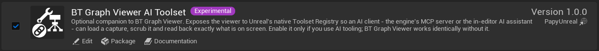

# AI / MCP Toolset

The AI toolset is **BT Graph Viewer AI Toolset**, a separate optional plugin for BT Graph Viewer.
It registers a **native Unreal Toolset**, so any AI client wired into Unreal's Toolset Registry (the
engine's [MCP server](https://dev.epicgames.com/documentation/unreal-engine/unreal-mcp-in-unreal-editor){target="blank"}) can drive the viewer directly. Your AI client
lists it as `BTGraphViewerToolset` among the available toolsets.

Every call drives the same viewer window a human uses. There is no parallel code path, and all of it
stays read-only with respect to your assets.

!!!info Optional
BT Graph Viewer has no dependency on this plugin and works the same without it. If you never use AI
tooling, you can ignore it.
!!!

## Requirements

| | |
|---|---|
| Plugins | **BT Graph Viewer** and the engine's **Toolset Registry** |
| Engine | Unreal Engine 5.8 |
| Status | Experimental, disabled by default |

Toolset Registry is an experimental plugin that ships with the engine and is disabled by default.
Enabling the AI toolset turns it on for you.

## Enabling it

1. Install BT Graph Viewer first (see [Getting Started](getting-started.md)).
2. Open **Edit → Plugins**, find **BT Graph Viewer AI Toolset** under **Tools** and enable it.
3. Accept the prompt to also enable the plugins it depends on, then restart the editor.

Typical loop: `LoadCapture` → `SelectAgent` → `SetFrame` → `GetViewerState`. That is enough for an
assistant to walk a capture and explain why an agent did what it did.

<video src="../static/videos/bgv_ai_session.mp4" autoplay loop muted playsinline controls style="width:100%"></video>

## Tool list

### OpenViewer

Opens or focuses the viewer tab.

### LoadCapture

Loads a `.bvlog` and returns the agents it contains.

### ListAgents

Lists loaded agents (paginated).

### SelectAgent

Selects an agent, as clicking it would.

### SetFrame

Moves the timeline to a frame.

### GetFrameInfo

Reports where the timeline sits.

### GetViewerState

Full state: active nodes, Blackboard, and the node ↔ execution-index map.

