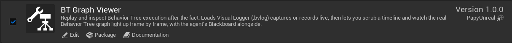
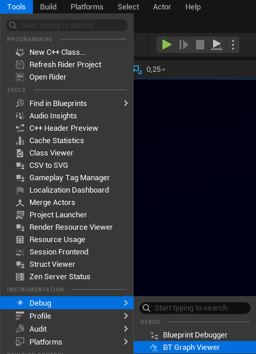
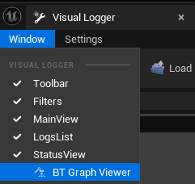

# Getting Started

## Requirements

| | |
|---|---|
| Engine | Unreal Engine 5.8 |
| Platforms | Editor-only (the plugin adds nothing to a packaged build) |
| Project type | C++ or Blueprint, no code changes required |

Your project must use `UBehaviorTreeComponent`-driven AI for there to be anything to record.

## Installation

1. Install the plugin from Fab: in the Epic Games Launcher, open your **Library**, find **BT Graph Viewer** and choose **Install to Engine** for your Unreal Engine 5.8.
2. Launch the editor.
3. Enable it under **Edit → Plugins → Tools → BT Graph Viewer**, then restart.

!!!info Manual install
If you have the plugin as a folder instead, copy the `BTGraphViewer` folder into your project's `Plugins/` directory, launch the editor and accept the rebuild if prompted. Then enable it as in step 3.
!!!

## Opening the tool

- **Tools → Debug → BT Graph Viewer**, or
- **Ctrl + Shift + B** (rebindable under *Editor Preferences → Keyboard Shortcuts*), or
- from inside the engine's own Visual Logger window: **Window → BT Graph Viewer**. See [Visual Logger docking](visual-logger-docking.md).

Via the **Tools** menu:

Via the Visual Logger window:

## Your first replay

1. Open the viewer and press **Start**.
2. Play your level and let the AI run.
3. Press **Stop**. Every agent that ran a Behavior Tree appears in the **Agents** list.
4. Click an agent, then drag on the timeline. The graph lights up frame by frame.

Want an AI assistant to drive the viewer? It is built in: see [AI / MCP Toolset](ai-toolset.md).

Next: [Recording & Loading](recording-and-loading.md) and [Interface](interface/index.md).
