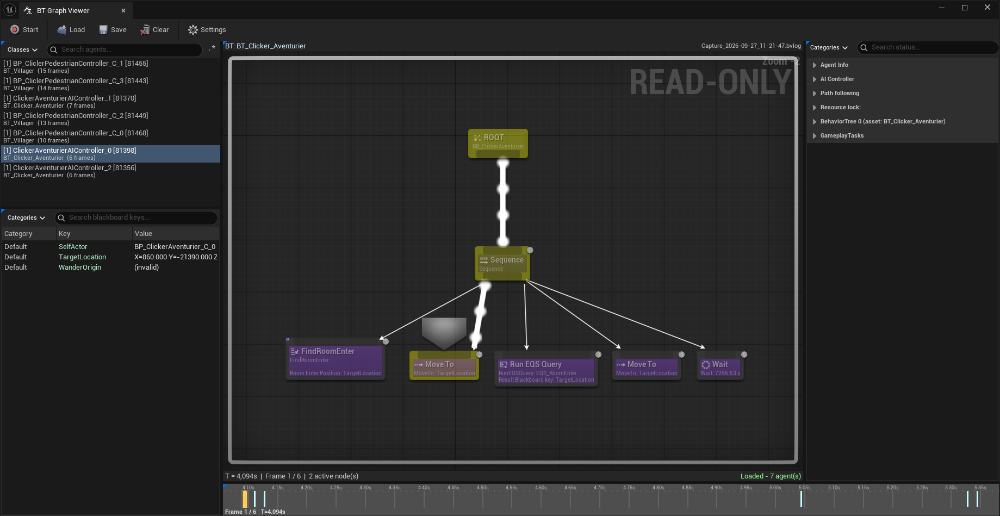

# Behavior Tree Graph Viewer

**Replay and inspect Behavior Tree execution after the fact.**

The stock Behavior Tree debugger only tells you what an agent is doing *right now*. Behavior Tree Graph Viewer
works from Visual Logger data instead: record a session (or open a `.bvlog` someone else captured),
then scrub a timeline and watch the real Behavior Tree graph light up frame by frame, with that
agent's Blackboard next to it.

Useful when the bug happened three minutes ago, on a machine that isn't yours.

!!! info Capture à produire : `bgv_home_hero`
**À montrer :** L'outil d'un coup d'œil : graphe, timeline et Blackboard. C'est aussi la vignette Fab.

**Mise en place :** Un arbre lisible avec une longue chaîne de nœuds actifs, une frame au milieu de la timeline, un Blackboard avec 5 clés ou plus.

**Cadrage :** 1920x1080. Masque le panneau Details et zoome le graphe pour remplir le cadre. Floute le chemin /Game/... s'il apparaît.
!!!

| | |
|---|---|
| Engine | Unreal Engine 5.8 |
| Platforms | Editor-only |
| Project type | C++ or Blueprint, no code changes required |
