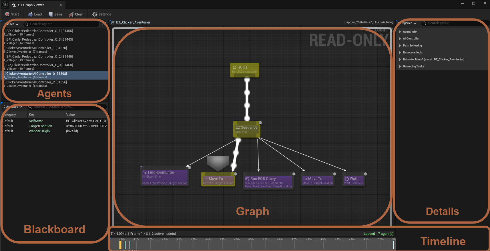
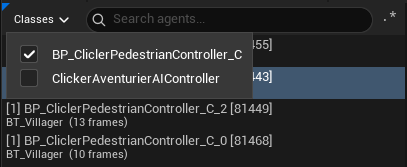
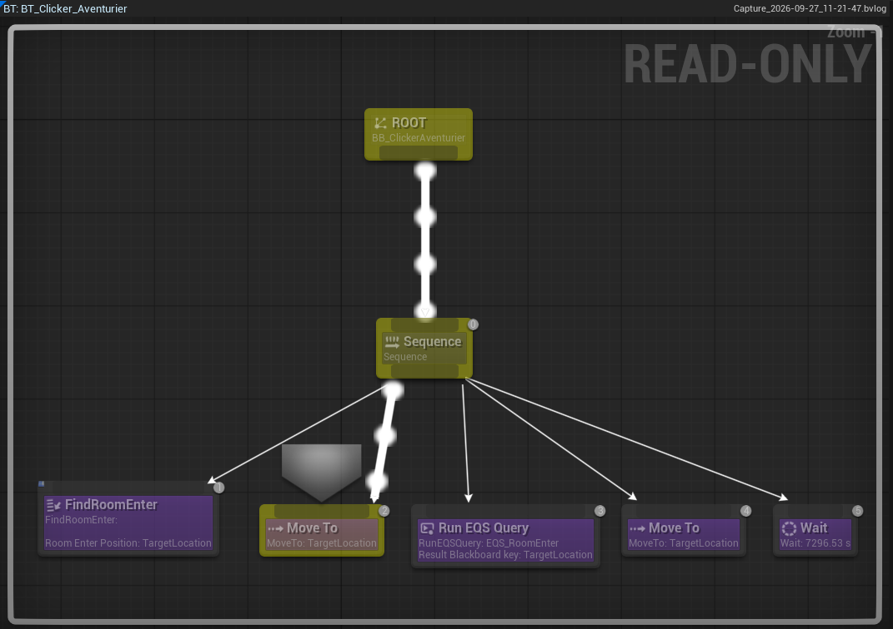
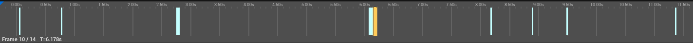
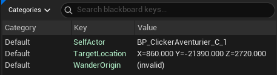
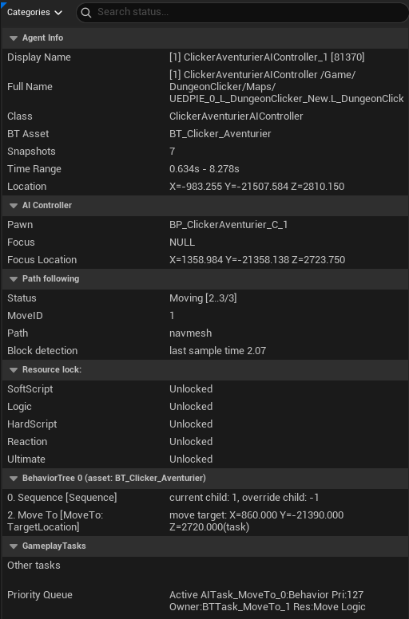

# Interface

The viewer is made of five panels around a toolbar.

Each panel is outlined and named in the image. The table below describes them in the same order.

| Panel | What it shows |
|---|---|
| **Agents** | Every recorded agent, its class, its Behavior Tree asset and its frame count. Filter by class or search by name. |
| **Graph** | The agent's actual Behavior Tree asset, with the nodes active at the current frame highlighted, plus the execution-index badge on each node. |
| **Timeline** | One marker per captured frame. Click or drag to scrub; ← / → step one frame. |
| **Blackboard** | Key/value pairs as they were at the selected frame. Searchable. |
| **Details** | The selected node's properties, styled after the engine's own Details panel. Right-click a value to copy it. |

A sixth panel, **Search**, opens on demand with **Ctrl + F**. See [Search](../search.md).

The **Agents** panel. The **Classes** menu filters the list by agent class.

The **Graph** panel at one frame: the active nodes are highlighted and each node shows its execution index.

The **Timeline**: one marker per captured frame, the orange one being the selected frame. The line under it shows the frame number and its time.

The **Blackboard** panel: each key and its value at the selected frame.

The **Details** panel, here showing the agent's status categories.

!!! info Read-only
The graph is the **real** Behavior Tree asset, shown read-only. Your assets are never modified or dirtied.
!!!
