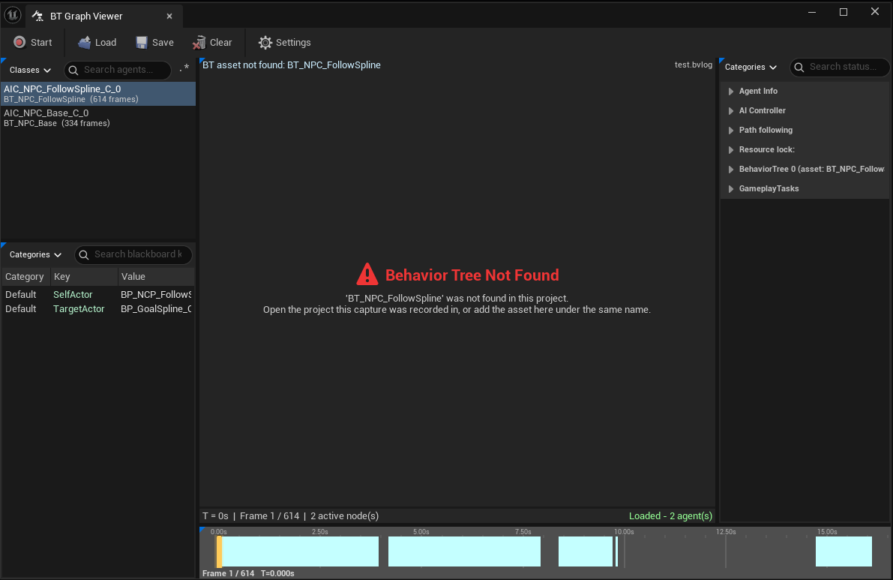

# Limitations & FAQ

## Known limitations

- **Editor only.** By design, this is a debugging tool.
- The Behavior Tree asset referenced by a capture must exist in the currently open project. The
  viewer resolves it by asset name through the Asset Registry. If it isn't found, the Graph panel
  says so instead of showing anything.
- Gameplay Debugger sync covers PIE/Game worlds and a single local player.
- Pressing **Stop** stops Visual Logger recording globally, exactly as the default Visual Logger
  window's Stop button does.

!!!warning Edited trees
If the Behavior Tree has been structurally edited (nodes added, removed, or reordered) since the
capture was recorded, the viewer cannot detect it. Node highlighting is matched by execution index,
which Unreal recomputes from the tree's current shape, so an old capture can end up highlighting the
wrong node with no warning. Keep captures close to the version of the tree they were recorded
against, especially before sharing one.
!!!

## FAQ

### The Graph panel says the Behavior Tree wasn't found.

The capture's Behavior Tree asset must exist in the open project. Open the project the capture came
from, or make sure the asset is present.

### Can I open a capture from another machine?

Yes. `.bvlog` files come from Unreal's standard Visual Logger.

### Does it change my Behavior Tree assets?

No. See [Read-only guarantee](read-only.md).

### Does it ship in my packaged game?

No. The plugin is editor-only.

## Reporting an issue

Please include:

- The **T** debug dump.
- The `.bvlog` file, if you can.
- A short plan to reproduce the bug (a few steps), or whatever is needed to reproduce it, such as the map, the Behavior Tree or a small test project.
