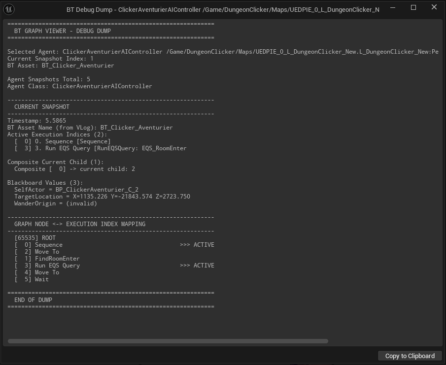

# Navigation & Shortcuts

| Action | How |
|---|---|
| Open the viewer | **Ctrl + Shift + B** |
| Scrub the timeline | Click or drag on the timeline |
| Step one frame | **←** / **→** |
| Zoom the timeline | **Ctrl** + mouse wheel over the timeline |
| Pan the timeline | Right-click and drag on the timeline |
| Search frames | **Ctrl + F** (see [Search](search.md)) |
| Plain-text dump of the current frame | **T** (with the viewer focused) |
| Copy a Details value | Right-click → **Copy** |

## The text dump

Press **T** to open a plain-text dump of the current frame: active execution indices, Blackboard
contents, and the full node ↔ execution-index mapping. A *Copy to Clipboard* button is provided,
which is usually what you want for a bug report.

Dragging the timeline cursor moves the graph from frame to frame:

<video src="../static/videos/bgv_timeline_scrub.mp4" autoplay loop muted="muted" playsinline controls style="width:100%"></video>

