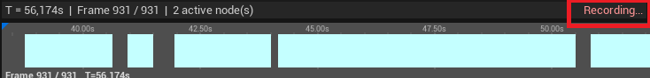
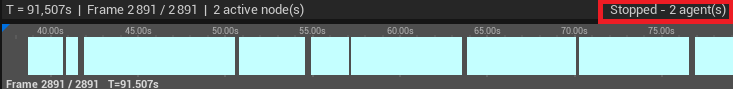
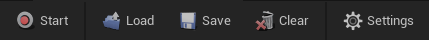
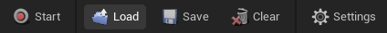
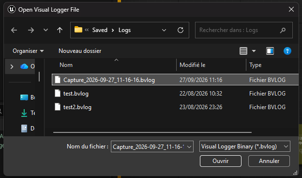
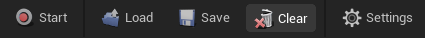
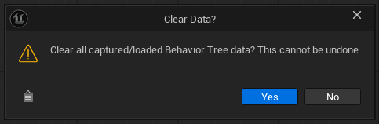

# Recording & Loading

## Recording live

1. Press **Start**. This turns on the engine's Visual Logger and begins capturing.
2. Play your level and let the AI misbehave.
3. Press **Stop**. Every agent that ran a Behavior Tree appears in the **Agents** list.

Stopping the Visual Logger from anywhere else (for example the default Visual Logger window) is
detected automatically and the toolbar reconciles itself.

!!!warning
Recording relies on the engine's global Visual Logger flag, which has no per-consumer reference
counting. Pressing **Stop** here stops Visual Logger recording globally, exactly as the default
Visual Logger window's Stop button does.
!!!

While recording, the status bar shows **Recording...** and the timeline grows as new frames are captured.

After **Stop**, the status bar shows how many agents were captured.

The toolbar has five buttons: **Start**, **Load**, **Save**, **Clear** and **Settings**.

## Loading a capture

Press **Load** and pick a `.bvlog` file. These are produced by Unreal's standard Visual Logger, so a
capture recorded by a teammate, or by a build running on another machine, opens fine.

The Behavior Tree asset referenced by the capture must exist in the currently open project. See
[Limitations & FAQ](limitations.md).

## Saving and clearing

- **Save** writes the current capture to a `.bvlog` file.
- **Clear** empties the viewer. There is no undo, so it asks for confirmation first when there is
  data to lose. You can turn the prompt off with **Confirm Before Clear** in [Settings](settings.md).

