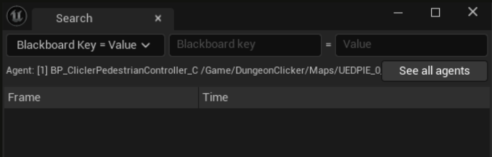
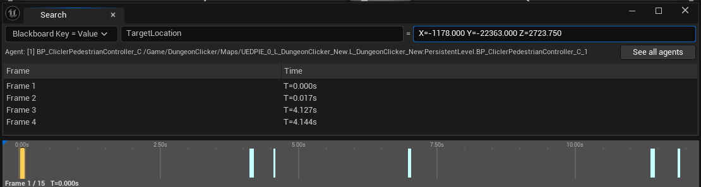
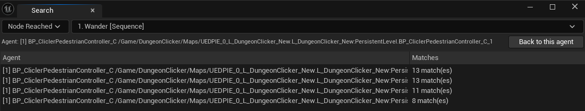

# Search

!!!warning WORK IN PROGRESS
The Search tab is still in development. Its behavior and interface may change in a future update.
!!!

The Search tab finds every frame of an agent where a condition is true, so you can jump straight to
the moment you care about instead of scrubbing.

Press **Ctrl + F** with the viewer focused to open it.

## Conditions

| Condition | Matches a frame when |
|---|---|
| **Blackboard Key = Value** | The Blackboard key has exactly that value on that frame |
| **Node Reached** | A node whose description contains your pick was active on that frame |

For **Node Reached**, you choose the node from a list built from the selected agent's own recorded
data, so you can only pick a node that exists in that capture.

An empty key or node never matches anything, so a half-filled condition does not flood the list.

Here is a **Blackboard Key = Value** search: the matching frames are listed, and marked on the timeline below.

## Results

Every matching frame is listed with its frame number and time.

- **Hover** a row to preview it without moving the timeline.
- **Click or double-click** a row to jump to that frame.
- **Multi-select** rows to see them marked on the timeline, in the *Timeline Multi Select Color*
  (see [Settings](settings.md)).

## Searching all agents

By default, a search only looks at the agent you selected. To check every agent at once:

1. Set your condition, then click **See all agents**.
2. You get a list of all recorded agents, each with the number of frames that matched.
3. Double-click an agent to open a new Search tab for that agent, with the same condition.
4. Click **Back to this agent** to return to the normal results list.

Here, a **Node Reached** search run on all agents:

The tab you opened with **Ctrl + F** always follows the agent you select. The new tab stays on the agent you double-clicked, so your original search is not changed. You can keep several Search tabs open at the same time.
