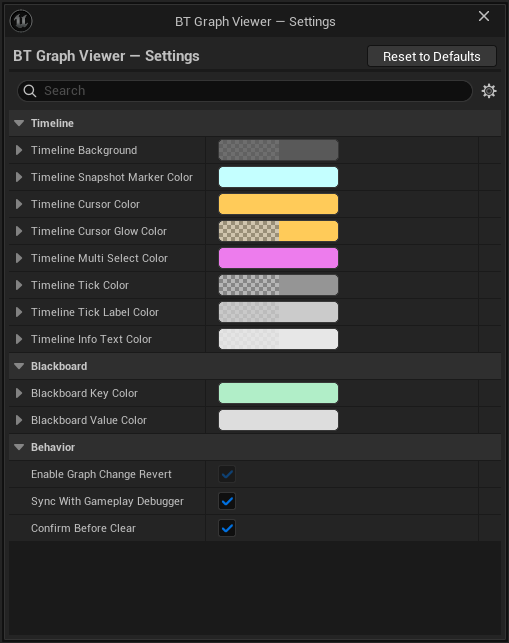

# Settings

Click **Settings** in the toolbar to open the settings window. Click it again to close it.

Every change is **saved and applied immediately**: the graph and the timeline redraw as
soon as you edit a value. **Reset to Defaults** (top right of the window) restores everything.

Settings are grouped in three categories.

## Timeline

Colors used by the timeline bar at the bottom of the viewer.

| Setting | What it colors |
|---|---|
| Timeline Background | Background of the timeline bar |
| Timeline Snapshot Marker Color | One marker per captured frame. Defaults to the native Visual Logger marker color |
| Timeline Cursor Color | The cursor showing the frame currently displayed |
| Timeline Cursor Glow Color | The soft glow around the cursor |
| Timeline Multi Select Color | Frames multi-selected in a [Search](search.md) results list, mirrored onto the timeline |
| Timeline Tick Color | The vertical tick lines |
| Timeline Tick Label Color | The time labels next to the ticks |
| Timeline Info Text Color | The text in the timeline's info line |

Changes apply live, as you edit the color:

<video src="../static/videos/bgv_settings_timeline.mp4" autoplay loop muted playsinline controls style="width:100%"></video>

## Blackboard

| Setting | What it colors |
|---|---|
| Blackboard Key Color | Key names in the Blackboard panel. Defaults to the native Visual Logger status view color |
| Blackboard Value Color | Values in the Blackboard panel |

## Behavior

| Setting | Default | What it does |
|---|---|---|
| Enable Graph Change Revert | On | Any graph modification (node move, connection, etc.) is automatically reverted, to keep the graph read-only. This option is greyed out so it cannot be changed: turning it off could modify the Behavior Tree asset in your project. See [Read-only guarantee](read-only.md) |
| Sync With Gameplay Debugger | Off | The viewer follows the actor selected in the Gameplay Debugger. See [Gameplay Debugger sync](gameplay-debugger-sync.md) |
| Confirm Before Clear | On | The **Clear** button asks for confirmation before wiping captured or loaded data. There is no undo, so turn this off only if the prompt gets in your way |

!!!danger DO NOT DISABLE
**Enable Graph Change Revert** is locked on. Turning it off would remove the read-only guarantee, and the viewer could then modify your Behavior Tree assets.
!!!

## Where settings are stored

Settings are stored per project in:

```
<YourProject>/Saved/Config/BTGraphViewerSettings.ini
```

Nothing is written inside the plugin folder, so engine-level installs (which are read-only) work.



