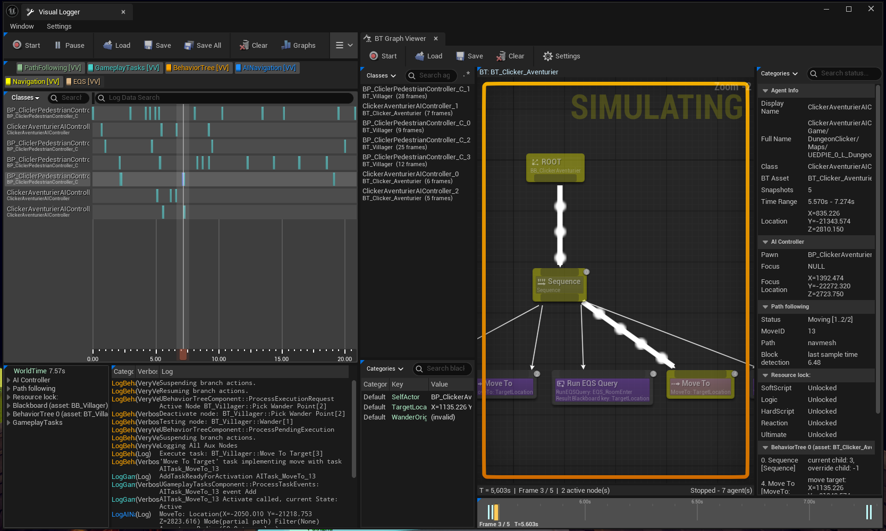

# Visual Logger docking

The viewer can also be opened from inside the engine's own Visual Logger window:
**Window → BT Graph Viewer**, listed with its Toolbar / Filters / MainView / LogsList / StatusView
panels.

Opened this way the viewer is a panel of that window, so it can be docked next to the Visual
Logger's timeline and log list. Drag its tab header to dock it wherever you want inside the window.

The standalone tab and the docked panel are independent instances: you can have both open at the
same time, each on its own capture.

